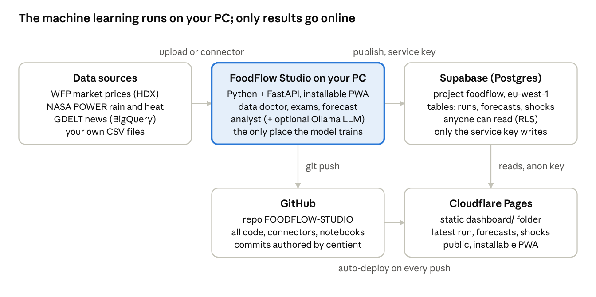

# FoodFlow documentation

The full, living system documentation (overview, what it predicts, data
sources and cleaning rules, pipeline, models, honest testing results,
what the results inform, architecture, glossary) is maintained here:

**FoodFlow — System Documentation:** https://claude.ai/artifact/RNTUco73ijziy6ARAhvrVt
(export it as PDF, Word or Markdown from the doc's menu)

Quick facts
- Target: log change of a food's retail price, one market, one month ahead.
- Data in the trained model: WFP market prices for Uganda (HDX), 2006–2026.
- Result on Uganda: beat "same as last month" in 4 of 4 walk-forward exams;
  right 59–64% of the time when it called a direction.
- Live data connectors: NASA POWER (weather), GDELT (news) — run on your PC.
